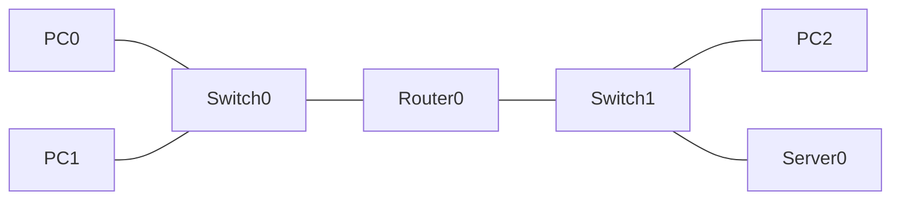

# Exercise 1 - Introduction to Packet Tracer, Networking Commands, Cables and Devices

## 1.a Introduction to Packet Tracer

Cisco Packet Tracer is a free network simulation tool from Cisco Networking Academy. It lets you design, configure and troubleshoot networks without physical hardware. It is a learning aid, not a replacement for practice on real routers, switches and servers.

**Benefits**
- Build any topology quickly and change it at no cost.
- Practise IOS command-line configuration safely.
- Watch packets move hop by hop in *Simulation* mode.
- Save and share a network as a single `.pkt` file.

**Packet Tracer file types**

| Extension | Meaning |
|---|---|
| `.pkt` | A saved network: topology, device settings and configurations |
| `.pka` | An activity file that adds instructions and scoring |

### User interface

| Area | Purpose |
|---|---|
| Logical / Physical workspace | Logical view for topology; physical view for racks, buildings and cabling |
| Device-type box (bottom left) | Choose routers, switches, hubs, end devices, connections |
| Realtime / Simulation toggle | Run live or step through packets |
| PDU list window | Shows events captured in Simulation mode |
| Menu and toolbar | Open, save, preferences, zoom, inspect, delete, add notes |

### Device configuration tabs

| Tab | Use |
|---|---|
| Physical | Power on/off, insert modules (for example a wireless NIC) |
| Config | GUI settings; shows the equivalent IOS commands |
| CLI | Full IOS command line |
| Desktop | IP configuration, command prompt, web browser, terminal (end devices) |
| Services | HTTP, DNS, DHCP and other services (servers) |

## 1.b Networking commands

| Command | Platform | Purpose |
|---|---|---|
| `ping <host>` | Windows/Unix | Tests reachability and measures round-trip time using ICMP |
| `tracert <host>` / `traceroute <host>` | Windows / Unix | Lists every router hop on the path to a destination |
| `arp -a` | Windows/Unix | Shows the IP-to-MAC address table of the local network |
| `ipconfig` / `ifconfig` | Windows / Unix | Shows IP address, mask and gateway of an interface |
| `netstat` | Windows/Unix | Lists open TCP/UDP connections, routing table and statistics |
| `nslookup` | Windows/Unix | Queries a DNS server to resolve a name |
| `ssh <user>@<host>` | Windows/Unix | Secure remote shell, replacement for Telnet |
| `curl` / `wget` | Windows/Unix | Fetch pages or files over HTTP/HTTPS/FTP |
| `whois` | Windows/Unix | Shows registration details of a domain |
| `tcpdump` | Unix | Captures and inspects packets on an interface |
| `nmap` | Windows/Unix | Discovers live hosts and open ports |
| `nc` (netcat) | Windows/Unix | Reads and writes data over network connections |
| `lsof` | Unix | Shows which process holds which open file or port |
| `iptraf` | Linux | Real-time traffic statistics per connection |
| `vnstat` | Linux/BSD | Monitors and logs network traffic per interface |
| `ngrep` | Unix | Pattern search in live network traffic |

### Practice in Packet Tracer - `Ex1b_Networking_Commands.pkt`

**Network:** two LANs joined by a router.

| Device | Interface | IP address | Mask | Gateway |
|---|---|---|---|---|
| PC0 | Fa0 | 192.168.10.1 | 255.255.255.0 | 192.168.10.254 |
| PC1 | Fa0 | 192.168.10.2 | 255.255.255.0 | 192.168.10.254 |
| Router0 | Gi0/0 | 192.168.10.254 | 255.255.255.0 | - |
| Router0 | Gi0/1 | 192.168.20.254 | 255.255.255.0 | - |
| PC2 | Fa0 | 192.168.20.1 | 255.255.255.0 | 192.168.20.254 |
| Server0 | Fa0 | 192.168.20.10 | 255.255.255.0 | 192.168.20.254 |

**Procedure**
1. Open `Ex1b_Networking_Commands.pkt` and wait for all link lights to turn green.
2. Click **PC0 > Desktop > Command Prompt**.
3. Run each command below and compare with the expected observation.

| Command (on PC0) | Expected observation |
|---|---|
| `ipconfig` | IP 192.168.10.1, mask 255.255.255.0, gateway 192.168.10.254 |
| `ipconfig /all` | Adds the MAC address and DNS details |
| `ping 192.168.10.2` | Replies from PC1 (the first request may time out while ARP resolves) |
| `ping 192.168.20.10` | Replies from the server, routed through Router0 |
| `arp -a` | Entries for devices this PC has already contacted |
| `tracert 192.168.20.10` | Two hops: first 192.168.10.254 (router), then 192.168.20.10 |
| `netstat` | Table of active connections (empty or short when idle) |

**Verification checklist**
- [ ] `ping` between PC0 and PC1 succeeds with 0% loss
- [ ] `ping` from PC0 to Server0 succeeds
- [ ] `tracert` shows the router as the first hop
- [ ] Screenshots saved in `screenshots/` (for example `ex1b_ping.png`, `ex1b_tracert.png`)

## 1.c Study of cables, connectors and devices

### Connectors and cables

| Term | Description |
|---|---|
| BNC | Connector used with coaxial cable |
| RJ-11 | 6-pin connector used on telephone lines |
| RJ-45 | 8-pin connector used for UTP Ethernet cable |
| UTP | Unshielded twisted pair: up to 4 twisted pairs; the twisting reduces electromagnetic interference |
| Coaxial | Copper core, insulation, metal mesh shield and outer jacket (ThinNet/ThickNet) |
| Fibre optic | Glass core and cladding carrying light; high bandwidth and long distance |

### Network devices

| Device | OSI layer | Function |
|---|---|---|
| Repeater | 1 | Regenerates the signal to extend distance (two ports) |
| Hub | 1 | Multiport repeater; all ports share one collision domain |
| Switch | 2 (3 for multilayer) | Forwards frames by MAC address; each port is its own collision domain |
| Bridge | 2 | Connects two LAN segments and filters by MAC address |
| Router | 3 | Forwards packets between different networks using IP addresses |
| Gateway | Any | Connects networks that use different protocols |

### Which cable to use

| Devices | Hub | Switch | Router | PC |
|---|---|---|---|---|
| **Hub** | Cross | Cross | Straight | Straight |
| **Switch** | Cross | Cross | Straight | Straight |
| **Router** | Straight | Straight | Cross | Cross |
| **PC** | Straight | Straight | Cross | Cross |

*Rule: like devices use a crossover cable, unlike devices use a straight-through cable. A console (rollover) cable connects a PC's RS-232 port to a router or switch console port.*

### Practice in Packet Tracer - `Ex1c_Cables_and_Devices.pkt`

The file shows one link for every device pair in the table above. A green link light means the right cable was chosen.

| # | Connection | Cable | Pair demonstrated |
|---|---|---|---|
| 1 | PC2 Fa0 - Hub0 Fa0 | Straight-through | PC - Hub |
| 2 | Hub0 Fa1 - Switch0 Fa0/1 | Crossover | Hub - Switch |
| 3 | Switch0 Fa0/2 - Switch1 Fa0/1 | Crossover | Switch - Switch |
| 4 | PC0 Fa0 - Switch0 Fa0/3 | Straight-through | PC - Switch |
| 5 | Switch0 Gi0/1 - Router0 Gi0/1 | Straight-through | Switch - Router |
| 6 | PC1 Fa0 - Router0 Gi0/0 | Crossover | PC - Router |
| 7 | PC3 RS 232 - Router0 Console | Console (rollover) | Management access |
| 8 | Router0 Gi0/2 - Router1 Gi0/0 | Crossover | Router - Router |
| 9 | Router1 Gi0/1 - Hub1 Fa0 | Straight-through | Router - Hub |
| 10 | Hub1 Fa1 - Hub2 Fa0 | Crossover | Hub - Hub |

**Verification checklist**
- [ ] All ten links show green lights
- [ ] Changing a cable to the wrong type (for example PC - Switch with a crossover) shows a red or amber link, then undo it
- [ ] Screenshot saved as `screenshots/ex1c_cables.png`
